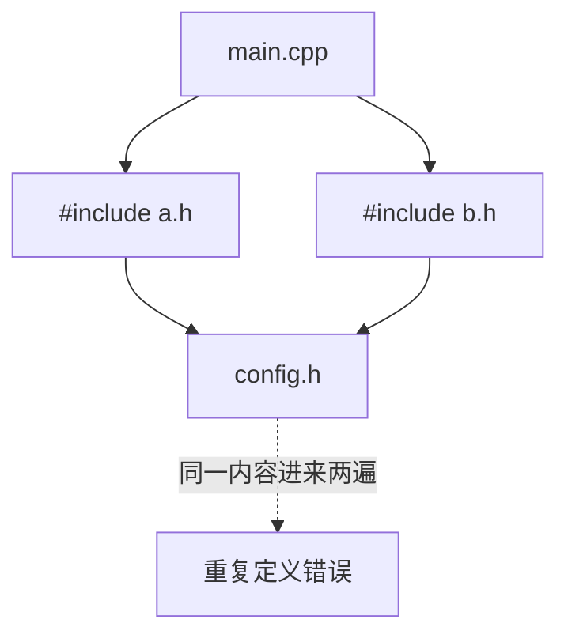

# 2.12 头文件保护（Header Guards）

📖 原文：[Header guards](https://www.learncpp.com/cpp-tutorial/header-guards/)

## 问题：重复包含

`a.h` include `config.h`，`b.h` 也 include `config.h`，`main.cpp` 同时 include `a.h b.h` → `config.h` 的内容被**拷贝两次** → 重复定义，编译错误。



## 解决：#ifndef / #define / #endif

```cpp
#ifndef MATH_UTILS_H     // 没定义过才继续
#define MATH_UTILS_H     // 标记"已包含"

// ...头文件全部内容...

#endif
```

第一次包含：`MATH_UTILS_H` 未定义 → 内容生效并打标记；
第二次包含：标记已存在 → 内容整体跳过。

**命名约定**：`全大写_文件名_H`，全项目唯一（如 `MATH_UTILS_H`）。

> 现代替代 `#pragma once`（非标准但所有主流编译器支持）。教程与跨平台库仍以 guard 为主，**两种都要认识**。

## 练习

`exercises/`：给缺保护的头文件补 guard，并复现重复包含报错。
